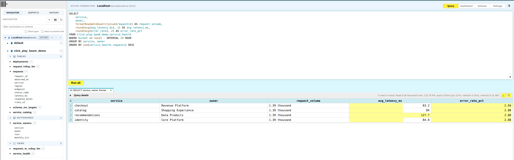
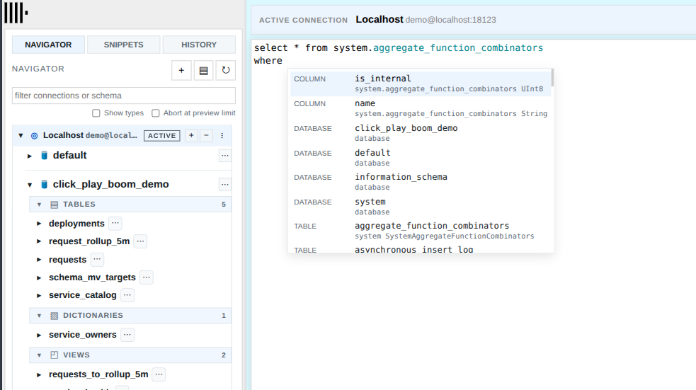
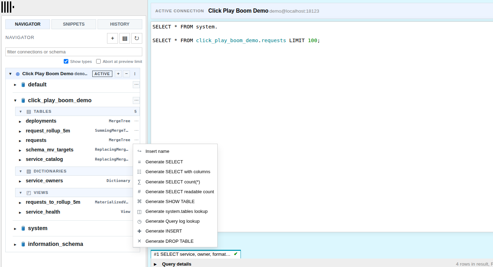
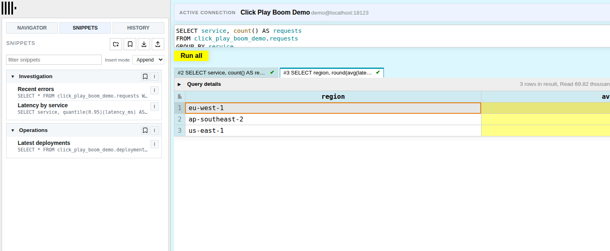
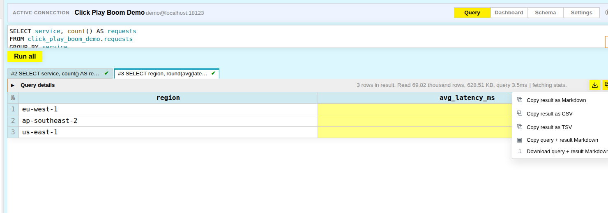
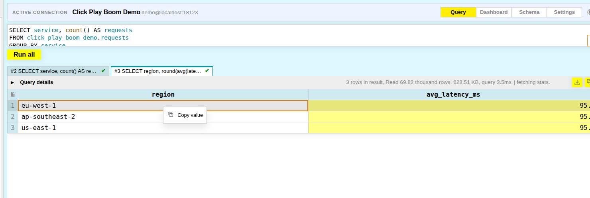
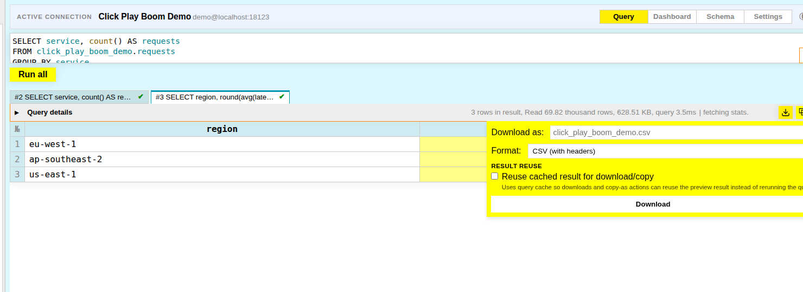
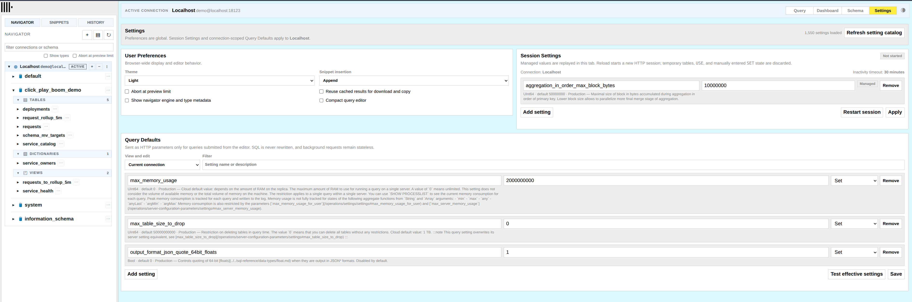
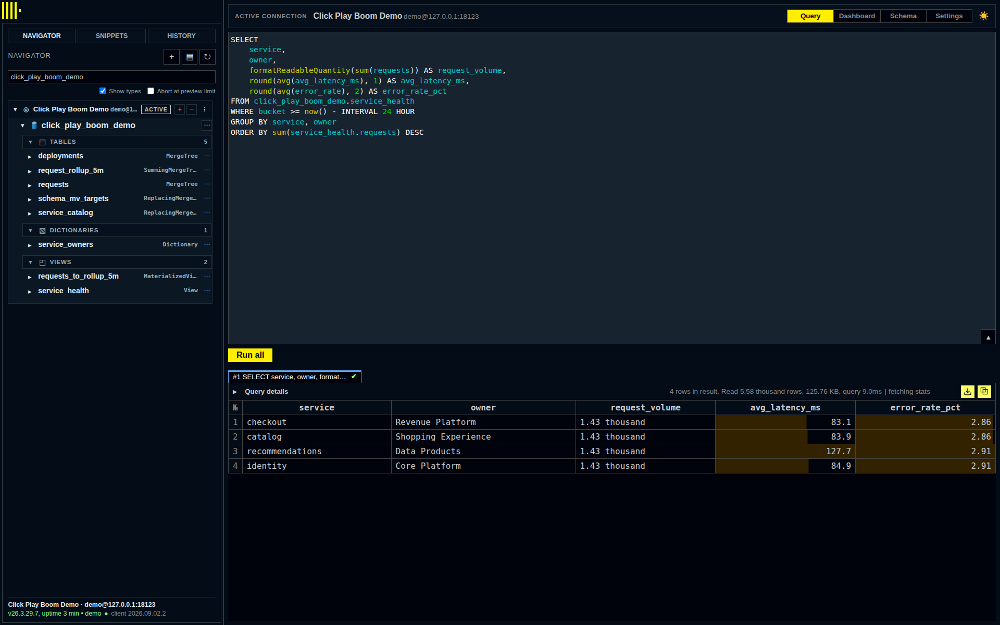

# Click Play Boom

**ClickHouse Play on steroids: a full ClickHouse workbench delivered as one deployable HTML file.**

Click Play Boom keeps the qualities that make the original ClickHouse Play page so useful—a direct connection to ClickHouse, a fast browser UI,
and no application server—then expands them into a practical environment for day-to-day work. Write and run SQL, explore servers, generate common
queries, inspect and export results, monitor dashboards, visualize schema dependencies, and control query behavior without installing a framework.

Open or serve [`click-play-boom.html`](./click-play-boom.html), connect to ClickHouse, and start working.



## Features

| Feature | What it gives you |
| --- | --- |
| **SQL authoring** | Syntax highlighting, schema-aware autocomplete, four-space indentation, richer undo, and a resizable or compact editor. |
| **True multi-statement execution** | Run an exact selection or every statement in a script, with sequential execution and an independent result tab for each statement. |
| **Navigator and connection manager** | Organize saved connections into folders, inspect server health and version, and lazily browse databases, tables, views, dictionaries, and columns. |
| **Context-aware SQL generation** | Generate common reads, counts, statistics, metadata lookups, inserts, and object-specific DDL directly from the schema navigator. |
| **Snippets and history** | Store reusable SQL in searchable folders, insert it in several ways, import or export collections, and revisit every statement executed in the current session. |
| **Result inspection and sharing** | Inspect query statistics, copy individual values, export results in common formats, or share a query and its result as one Markdown document. |
| **Flexible downloads** | Download results in common or custom ClickHouse formats with useful filenames and optional query-cache reuse for expensive results. |
| **Dashboards and visualizations** | Explore native ClickHouse dashboards, query charts, `EXPLAIN` graphs, schema relationships, materialized-view flows, and pipeline load. |
| **Scoped settings** | Manage browser-wide preferences, per-connection HTTP session settings, and global or connection-specific query defaults. |
| **Standalone deployment** | Run the entire workbench from one self-contained HTML file, locally or from any web server. |

The product is organized into four connected workspaces—**Query**, **Dashboard**, **Schema**, and **Settings**—but the active connection follows you
between them. Features such as the navigator, snippets, and history remain available in the shared sidebar.

## Quick Start

Open [`click-play-boom.html`](./click-play-boom.html) directly in a browser. A file-based launch defaults to:

```text
http://localhost:8123/
```

Select **New connection** (`+`) in the Navigator to save another ClickHouse server. When the page is served over HTTP, the initial connection
defaults to the page's origin. Connection details can also be supplied in the URL:

```text
click-play-boom.html?url=http%3A%2F%2Flocalhost%3A8123%2F&user=default
```

Click Play Boom sends `add_http_cors_header=1`, so ClickHouse must be reachable from the browser and allow the request. Saved connection details,
including passwords, are stored in browser `localStorage`; treat this as a local/development convenience rather than a secure secret store. A
password supplied in the URL is removed from the address after initialization, but is still stored with the saved connection.

### Try the Demo

The included demo provides an isolated ClickHouse 26.3 LTS instance and a realistic `click_play_boom_demo` database. It contains MergeTree tables,
an active materialized-view pipeline, a normal view, a dictionary, Schema compatibility metadata, 80,640 request events, and 240 deployment
records. Initialization runs only when the demo volume is first created.

Start it with:

```bash
docker compose -f demo/compose.yaml up -d --wait
```

Open [`click-play-boom.html`](./click-play-boom.html), select **New connection** (`+`), and use:

| Setting | Value |
| --- | --- |
| HTTP interface | `http://localhost:18123/` |
| Native interface | `localhost:19000` |
| Username | `demo` |
| Password | `clickplayboom` |
| Database | `click_play_boom_demo` |

To recreate the demo data, remove only its containers and volume, then start it again:

```bash
docker compose -f demo/compose.yaml down --volumes
docker compose -f demo/compose.yaml up -d --wait
```

## SQL Authoring and Multi-Statement Execution

The Query workspace is a SQL script buffer rather than a single-query box:

- Run selected text—or every statement when nothing is selected—with `Ctrl+Enter` / `Cmd+Enter`.
- Split scripts with the embedded ClickHouse WebAssembly lexer, with a simple semicolon fallback when WebAssembly is unavailable.
- Execute statements sequentially and keep each response in its own status-bearing result tab.
- Complete databases, tables, views, dictionaries, aliases, and columns from lazily loaded schema metadata.
- Load table and column metadata on demand when qualified names are typed, even if the navigator branch has not been opened.
- Use four-space Tab indentation, Shift+Tab outdent, syntax highlighting, a resizable editor, compact mode, and editor-aware undo.
- Keep inserted or generated runnable SQL selected so it can be executed immediately.

### Schema-aware autocomplete

Autocomplete understands qualified database and table names as well as tables referenced by the current statement.



### True script execution

Unlike the stock Play workflow, a script can contain several statements and run them all in one action. Each statement receives its own result tab,
status, statistics, and history entry.


## Navigator and SQL Generation

The Navigator combines connection management with a lazy schema browser:

- Save multiple ClickHouse connections, organize them into folders, and switch the active connection without leaving the page.
- See connection status, server version, table engines, column types, row estimates, and storage sizes at a glance.
- Filter connections and loaded schema from one search box.
- Browse tables, materialized views, normal views, and dictionaries as distinct object types.
- Double-click database, table, view, dictionary, or column names to insert correctly qualified identifiers at the cursor.
- Refresh schema metadata after server changes without reloading the application.

Object-aware actions generate SQL in the editor for review rather than executing hidden operations. Table and view actions include:

- `SELECT *` and `SELECT` with all columns
- `count(*)` and `formatReadableQuantity(count(*))`
- `SHOW TABLE`, `system.tables`, and `system.query_log` lookups
- `INSERT` templates
- Type-correct `DROP TABLE`, `DROP VIEW`, `DROP MATERIALIZED VIEW`, and `DROP DICTIONARY` statements
- Cluster-aware destructive statements where matching Keeper metadata is available



Numeric columns can generate ready-to-run quantile, minimum, average, and maximum statistics queries.


## Snippets and History

Snippets turn the sidebar into a lightweight SQL library or command palette:

- Organize snippets into searchable, reorderable folders.
- Append a snippet, insert it at the cursor, or replace the editor contents.
- Choose a default insertion mode while retaining per-snippet actions.
- Import and export complete snippet collections as JSON.
- Preserve newer snippet and connection changes when several browser tabs are open.



History records each statement—not merely each click of Run—with its status, connection, query summary, statistics, and link to the corresponding
result tab. Queries can also be copied directly from history. History belongs to the current browser session and resets when the page reloads.

## Results, Copying, and Downloads

Every executed statement receives an independent result panel. Click Play Boom renders streaming tables, raw ClickHouse formats,
`JSONCompactColumns` charts, and ClickHouse `EXPLAIN` graphs while preserving earlier results for comparison.

Result summaries expose row counts, transfer volume, elapsed query time, client/network timing, memory use, and statistics recovered from
`system.query_log`. Query details remain available without taking over the result area.

### Share results without rerunning the query

Tabular results can be copied as Markdown, CSV, or TSV. Copy the SQL and its result together as a ready-to-share Markdown document, download the
same combined document, copy the original query, or copy supported rendered text formats directly.



Right-click any result cell to copy its exact value without dragging across a wide table or accidentally including neighboring whitespace.



### Download in the format you need

Downloads support named CSV and TSV files with headers, JSON, Parquet, Markdown, Arrow, Avro, ORC, Native, RowBinary, and many other ClickHouse
formats. Enter a custom format name when the server supports something newer. Filenames can be supplied explicitly or derived from the first table
in the query, with normalized extensions such as `.csv`, `.tsv`, `.jsonl`, `.parquet`, and `.md`.



For large or expensive queries, optional ClickHouse query-cache integration lets copy and download actions reuse the preview result instead of
rerunning the original query.

## Dashboards

The Dashboard workspace loads definitions exposed by `system.dashboards` and renders them inside the application using the active connection.
Relative and absolute time ranges and bucket controls apply immediately, while synchronized zoom makes it easy to investigate the same period
across several charts.

Charts can be reset, expanded vertically, and reordered by dragging. Add, edit, or remove charts for the current session, or work with the entire
dashboard definition in the built-in JSON editor.


The repository includes [`demo/dashboard.json`](./demo/dashboard.json), the four-chart definition used by the demo.

## Schema Visualization

The Schema workspace turns ClickHouse metadata into an explorable view of how data is structured and moves through the server:

- Search tables and columns, filter databases, include system tables, and toggle column detail.
- Follow table and view dependencies, materialized-view targets, dictionary sources, and Distributed table relationships.
- Inspect engines, keys, row and byte counts, comments, refresh state, and lazily formatted `CREATE` statements.
- Re-layout, drag, select, and zoom the graph to focus on the part of the system that matters.
- Colour materialized-view pipelines by executions, rows, bytes, duration, or memory recorded in `system.query_views_log`.
- Supply compatibility metadata for ClickHouse versions that do not expose materialized-view targets in `system.tables`.


## Scoped Settings and Preferences

The Settings workspace brings browser preferences and query behavior together. Its ranked, virtualized picker makes every matching entry from
`system.settings` searchable without rendering the entire catalog into the page.

Settings are deliberately separated by scope:

- **User Preferences** control browser-wide display and editor behavior, including theme, snippet insertion, result reuse, navigator detail,
  preview limits, and compact editor mode.
- **Session Settings** are managed per connection and browser tab. Click Play Boom replays configured values into a dedicated ClickHouse HTTP
  session, detects busy or expired sessions, performs one controlled recovery, and starts a fresh session after a reload.
- **Query Defaults** are sent as HTTP parameters without rewriting SQL. Define them globally, override or suppress them for individual connections,
  and test the effective values before running a query.



Dashboard, Schema, navigator, autocomplete, download, and query-log requests remain stateless; only editor queries use the managed session and
Query Defaults.

Light, dark, and system-driven themes apply consistently across every workspace. The main screenshots use the light theme to retain ClickHouse
Play's visual lineage; the same Query workspace is shown below in dark mode.



## Development and Contributing

The repository separates maintainable source from the deployable application:

- [`click-play-boom.html`](./click-play-boom.html) is the generated, committed application artifact.
- [`src/`](./src/) contains the editable HTML, CSS, JavaScript, templates, and embedded assets.
- [`tools/build-single-file.mjs`](./tools/build-single-file.mjs) assembles the source tree into the root HTML artifact.
- [`demo/`](./demo/) contains the reproducible ClickHouse environment and screenshot dashboard definition.

No npm installation or bundler is required to run the generated application. Development uses Node for the small build tool and Playwright for
focused browser safety tests. Edit files under `src/`, then regenerate the artifact:

```bash
npm run build
```

Install the repository-managed pre-commit hook once to regenerate and stage the artifact automatically:

```bash
npm run hooks:install
```

Useful development checks are:

```bash
npm run build:check
npm run browsers:install
npm run test:query-submit
node --check tools/build-single-file.mjs
find src/scripts -name '*.js' -print0 | xargs -0 -n1 node --check
docker compose -f demo/compose.yaml config --quiet
```

Inspect the seeded demo data from the command line with:

```bash
docker compose -f demo/compose.yaml exec clickhouse \
  clickhouse-client --user demo --password clickplayboom \
  --query "SELECT service, count() FROM click_play_boom_demo.requests GROUP BY service ORDER BY service"
```

The generated page embeds its CSS, application JavaScript, templates, icons, and ClickHouse lexer. It loads no external resources during startup;
the larger upstream visualization libraries used for charts and `EXPLAIN` graphs are fetched lazily only when those features are requested.

## Project Status

Click Play Boom is an actively developed, browser-based ClickHouse workbench intended for direct use against servers reachable from the browser.
Its standalone architecture keeps deployment deliberately simple, while browser CORS rules and the local storage of connection credentials make
it best suited to trusted local, development, and internal environments.

## Lineage

Click Play Boom is a substantial rework of the ClickHouse Play page from
[`ClickHouse/ClickHouse` v26.3.3.20-lts](https://github.com/ClickHouse/ClickHouse/blob/v26.3.3.20-lts/programs/server/play.html). It preserves the
original's fast, standalone deployment model and familiar interaction style while expanding it into a practical day-to-day workbench.
