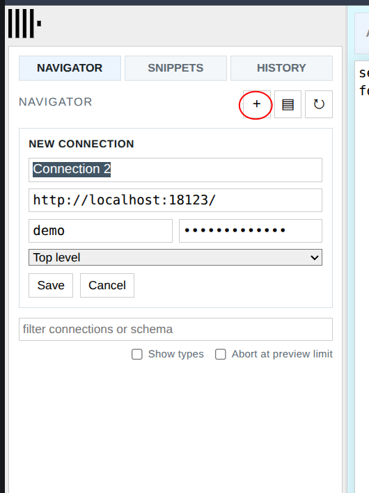
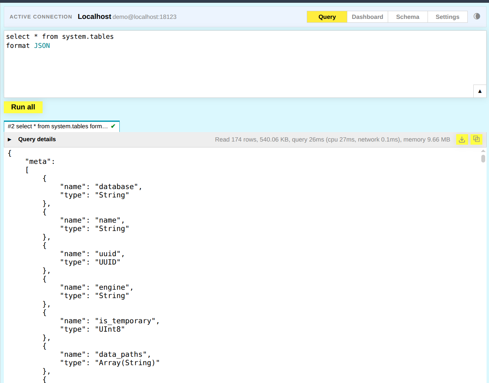
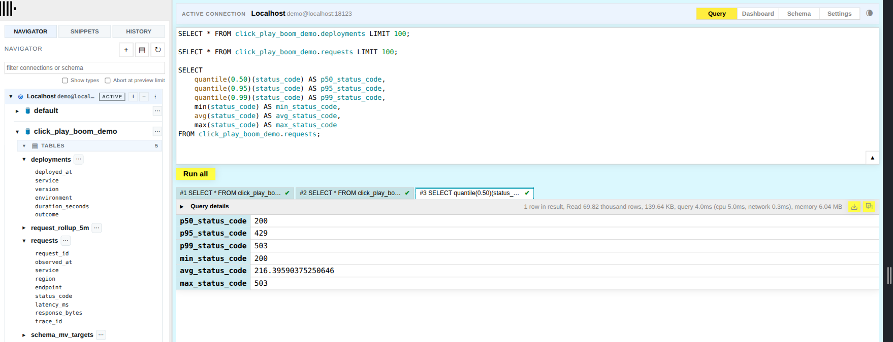
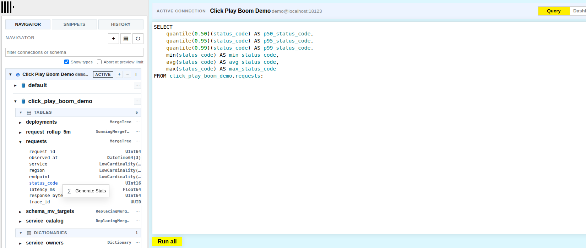
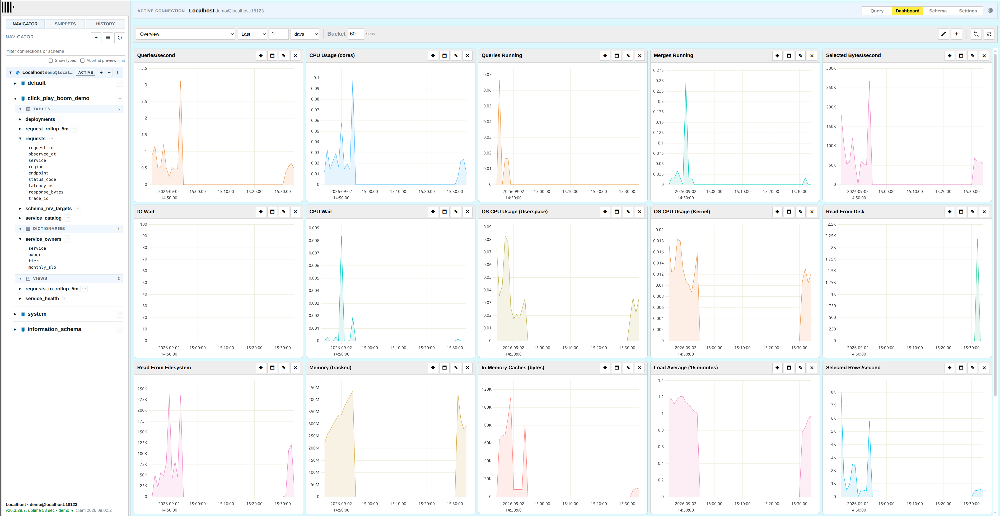
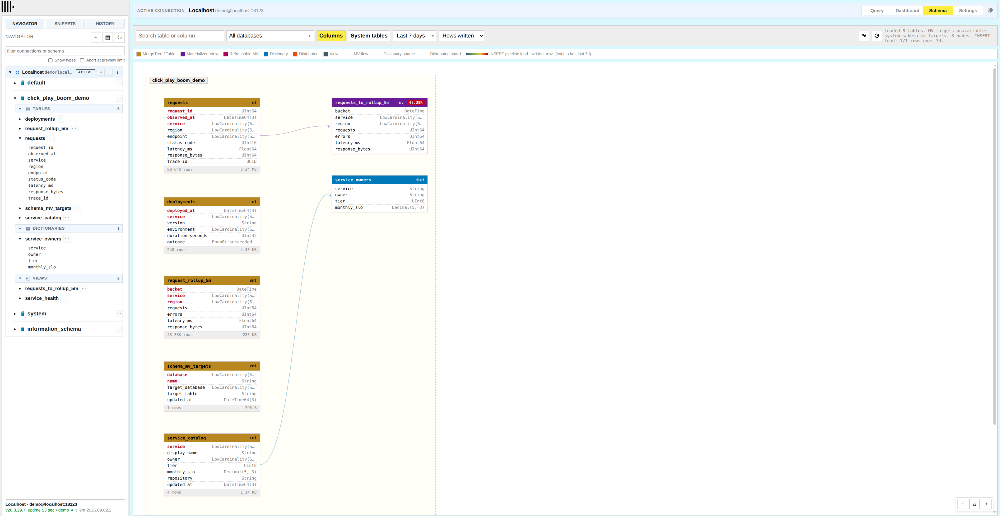

# Click Play Boom

**ClickHouse Play with added 💥: a full ClickHouse workbench delivered as one deployable HTML file.**

**Click Play Boom doesn't try to reinvent ClickHouse. It gets out of its way.**

Click Play Boom keeps the qualities that make the original ClickHouse Play page so useful—a direct connection to ClickHouse, a fast browser UI, and no application server—then expands them into a practical environment for day-to-day work. Write and run SQL, explore servers, generate common queries, inspect and export results, monitor dashboards, visualize schema dependencies, and control query behavior without installing a framework.

Open or serve [`click-play-boom.html`](./click-play-boom.html), connect to ClickHouse, and start working.


## Quick Start

### ClickHouse running on localhost:8123?

- Open [`click-play-boom.html`](./click-play-boom.html) in a browser.
- Done. Yep, that's it.

### ClickHouse running elsewhere?

- Open [`click-play-boom.html`](./click-play-boom.html) in a browser.
- Click the `+` in the Navigator to add a new connection.

  
- Enter the connection name, HTTP URL, username and password.
- Done.

## Features - At a Glance

| Feature                              | What it gives you                                                                                                                                               |
| :----------------------------------- | :-------------------------------------------------------------------------------------------------------------------------------------------------------------- |
| **SQL authoring**                    | Syntax highlighting, schema-aware autocomplete, four-space indentation, richer undo, and a resizable or compact editor.                                         |
| **True multi-statement execution**   | Run an exact selection or every statement in a script, with sequential execution and an independent result tab for each statement.                              |
| **Navigator and connection manager** | Organize saved connections into folders, inspect server health and version, and lazily browse databases, tables, views, dictionaries, and columns.              |
| **Context-aware SQL generation**     | Generate common reads, counts, statistics, metadata lookups, inserts, and object-specific DDL directly from the schema navigator.                               |
| **Snippets and history**             | Store reusable SQL in searchable folders, insert it in several ways, import or export collections, and revisit every statement executed in the current session. |
| **Result inspection and sharing**    | Inspect query statistics, copy individual values, export results in common formats, or share a query and its result as one Markdown document.                   |
| **Flexible downloads**               | Download results in common or custom ClickHouse formats with useful filenames and optional query-cache reuse for expensive results.                             |
| **Dashboards and visualizations**    | Explore native ClickHouse dashboards, query charts, `EXPLAIN` graphs, schema relationships, materialized-view flows, and pipeline load.                         |
| **Scoped settings**                  | Manage browser-wide preferences, per-connection HTTP session settings, and global or connection-specific query defaults.                                        |
| **Standalone deployment**            | Run the entire workbench from one self-contained HTML file, locally or from any web server.                                                                     |

The product is organized into four connected workspaces—**Query**, **Dashboard**, **Schema**, and **Settings**—but the active connection follows you between them. Features such as the navigator, snippets, and history remain available in the shared sidebar.

## Why not DBeaver, DataGrip, CH-UI or similar tools?

DBeaver and DataGrip are capable general-purpose database clients. [CH-UI](https://github.com/caioricciuti/ch-ui) is a broader ClickHouse platform, bringing SQL editing together with dashboards, monitoring, scheduling and AI.

**Click Play Boom is deliberately a ClickHouse workbench, not another data platform.** It works directly with ClickHouse over HTTP, without a separate backend or a layer that restricts native SQL and result formats.

| Feature | Click Play Boom | DBeaver | DataGrip | CH-UI |
| :--- | :---: | :---: | :---: | :---: |
| SQL editor, autocomplete and history | ✅ | ✅ | ✅ | ✅ |
| Multi-statement script execution | ✅ | ✅ | ✅ | ✅ |
| Execute selected multi-statement SQL | ✅ | ⚠️ | ✅ | ✅ |
| Explicit ClickHouse `FORMAT` output | ✅ | ❌ | ❌ | ❌ |
| Copy native formatted results | ✅ | ❌ | ❌ | ❌ |
| Persistent ClickHouse session settings | ✅ | ✅ | ✅ | ❌ |
| Integrated ClickHouse settings management | ✅ | ❌ | ❌ | ❌ |
| Materialized-view pipeline visualization | ✅ | ❌ | ❌ | ✅ |
| Pipeline execution metrics | ✅ | ❌ | ❌ | ⚠️💲 |
| Native `system.dashboards` integration | ✅ | ❌ | ❌ | ❌ |
| Broad ClickHouse-native downloads | ✅ | ❌ | ❌ | ⚠️ |
| No installation or additional backend | ✅ | ❌ | ❌ | ❌ |

✅ Supported · ⚠️ Limited, different or not fully evaluated · ❌ Unsupported in the tested workflow · 💲 Related monitoring is available in CH-UI Pro; equivalent per-materialized-view metrics have not been verified.

### A practical example

Run the same SQL against the same ClickHouse server:
```sql
SELECT *
FROM system.aggregate_function_combinators
FORMAT JSON;
```

| Client | Result |
| :--- | :--- |
| **Click Play Boom** | ✅ Displays ClickHouse's JSON response, ready to copy |
| **DBeaver 26.0.0** | ❌ JDBC driver rejects the format |
| **DataGrip 2026.3** | ❌ JDBC driver rejects the format |
| **CH-UI 2.33.1** | ❌ Reports a successful query but displays no JSON |



DBeaver and DataGrip can export result grids as JSON; that's different from executing SQL with `FORMAT JSON` and displaying the response ClickHouse actually returns. CH-UI supports server-side export in a limited selection of formats, but its query editor did not display explicitly requested JSON, Markdown or XML in our tests.

Click Play Boom also displays formats such as Markdown, XML and CSV as returned by ClickHouse. **Copy rendered result** takes that output directly to the clipboard, so you can paste native Markdown into documentation, JSON into a tool, or CSV into another workflow without a separate conversion step. Downloads can request server-native formats including Parquet, Arrow, Native and more.

The same philosophy extends to settings. In our tests, DBeaver, DataGrip and Click Play Boom retained a `SET max_threads = 2` value into a subsequent query. CH-UI's subsequent query returned the default. Click Play Boom also lets you browse `system.settings`, manage HTTP-session values and configure per-query defaults explicitly.

**The difference is focus.** Use the tool that suits the job: Grafana for cross-source dashboards, cron or an orchestrator for scheduled work, and Click Play Boom for exploring, querying and understanding ClickHouse. No new platform to operate just to run SQL.

## Features

### SQL Authoring and Multi-Statement Execution

Unlike the stock ClickHouse Play interface, the editor works as a proper SQL script buffer, much like the query editors in pgAdmin, DBeaver, SSMS or MySQL Workbench. Keep several statements in the same editor and run all of them, or just the ones you need.

- **Run everything:** With no text selected, click **Run All** to execute every statement in the editor.
- **Run a selection:** Highlight one or more statements and click **Run Selected** to execute only that selection.
- **Use the keyboard:** `Ctrl+Enter` (`Cmd+Enter` on macOS) runs the current selection, or all statements if nothing is selected.
- **Keep the results:** Statements execute sequentially, each with its own result tab, status, statistics and history entry. You can move between results without rerunning anything.

The editor also supports syntax highlighting, four-space Tab indentation, `Shift+Tab` to outdent, undo, resizing and a compact mode. SQL generated or inserted by other parts of the application is selected ready to run. Statements are split using ClickHouse's WebAssembly lexer, with a semicolon-based fallback if WebAssembly is unavailable.



### Schema-aware autocomplete

Autocomplete uses the schema of the connected ClickHouse server rather than just guessing SQL keywords. It understands database-qualified names, tables referenced in the current statement, aliases and their columns, as well as views and dictionaries.

- Type a `.` after a database, table or alias to see relevant completions.
- Press **`Ctrl+Space`** to request suggestions without a dot, for example when completing SQL clauses such as `WHERE`.
- You don't need to expand the relevant table in the Navigator first: metadata can be loaded when you type a qualified name.


### Navigator and SQL Generation

The Navigator in the sidebar is both a connection manager and a schema browser. Save several ClickHouse servers, group connections into folders and switch between them without opening another page. It shows connection status and server version, then loads databases and their objects as you explore them, rather than fetching the entire schema up front.

Use the search box to filter connections and loaded schema. Expand a database to browse its tables, ordinary and materialized views, dictionaries and columns, including engine, type, row estimates and storage information. Double-click a database, object or column to insert its properly qualified name into the SQL editor. Refresh the schema after changing objects on the server.

The useful bit is the context menu: **right-click an object to generate SQL for it** rather than typing the same queries from scratch. Depending on the object, you can generate:

- `SELECT *` or an explicit `SELECT` containing all columns.
- `count(*)` or `formatReadableQuantity(count(*))`.
- Metadata lookups using `SHOW TABLE`, `system.tables` or `system.query_log`.
- `INSERT` templates and type-correct `DROP` statements for tables, views, materialized views and dictionaries.
- Cluster-aware destructive statements where matching Keeper metadata is available.

Generated SQL appears in the editor for you to review and run; the Navigator doesn't execute destructive operations behind your back.


Numeric columns have their own statistics generation, including quantiles, minimum, average and maximum. Useful when you're exploring unfamiliar data and don't fancy typing a miniature analytics query every time.



### Snippets and History

**Snippets** are saved bits of SQL you want to reuse. Organize them into folders, search for them and insert them into the editor without hunting through old files or query tabs.

- Append a snippet to your existing script, insert it at the cursor or replace the editor contents.
- Set your preferred insertion method as the default, while retaining the other actions for individual snippets.
- Import and export the complete snippet library as JSON. Changes to snippets and connections are reconciled when you have several browser tabs open.


**History** records individual executed statements, not just each click of **Run**. Revisit the SQL, see its connection, status and statistics, copy it or jump back to the matching result tab. History lasts for the current browser session; reloading the page clears it.

### Results, Copying and Downloads

#### ClickHouse formats are first-class results

ClickHouse supports far more than conventional row-and-column results. Add `FORMAT JSON`, `FORMAT Markdown`, `FORMAT XML` or another supported textual format to a query and Click Play Boom shows the response itself, rather than forcing it through a grid renderer. Copy the rendered result straight to the clipboard or download it for use elsewhere.

This is intentionally different from exporting a table *as* JSON or Markdown after execution: **ClickHouse chooses the serialization**, not the client.

Every statement gets its own result tab, so running another query doesn't replace the last result. The viewer handles tabular and streaming responses, raw ClickHouse output formats, `JSONCompactColumns` charts and `EXPLAIN` graphs.

The result summary exposes the details you generally need when investigating performance: rows returned, transfer size, query and network timing, memory use and, where available, additional figures from `system.query_log`.

#### Copy results or share the query with them

You don't have to reformat a result or take screenshots just to share it with someone.

- Copy tabular results as **Markdown**, **CSV** or **TSV**.
- Copy or download **the SQL and its result together** as a single Markdown document, so the recipient can see exactly where the data came from.
- Copy just the SQL, or copy supported rendered text output directly.
- **Right-click a cell** to copy its exact value, rather than selecting text across an entire row.


#### Download in the format you need

Use the download options to get results out of the browser in a format another tool can consume. Supported formats include CSV and TSV with headers, JSON, Parquet, Markdown, Arrow, Avro, ORC, Native and RowBinary, plus custom formats supported by your ClickHouse server.

Give the file a name yourself or let Click Play Boom derive one from the first table in the query, with an appropriate extension such as `.csv`, `.tsv`, `.jsonl`, `.parquet` or `.md`.


For expensive queries, optional ClickHouse query-cache integration can let copy and download operations reuse the preview result instead of rerunning the original query just to export it.

### Dashboards

The **Dashboard** workspace displays dashboards defined by ClickHouse in `system.dashboards` using your current connection. It's a way to explore those charts alongside your queries, without moving to a separate monitoring application.

Choose a relative or absolute time range and adjust the chart buckets. Zooming is synchronized across charts, making it easier to compare the same spike or slowdown in several metrics. You can reset or expand charts, drag them into a different order, and add, edit or remove charts for the current session. There's also a JSON editor for working with the complete dashboard definition.



The demo includes a four-chart definition at [`demo/dashboard.json`](./demo/dashboard.json) if you want something to explore immediately.

### Schema Visualization

The **Schema** workspace is for understanding how a ClickHouse database fits together, particularly when it has a lot of views and materialized-view pipelines. Instead of following `CREATE` statements manually, explore the relationships as a graph.

- Search for tables or columns, select databases, optionally include system tables and show or hide column detail.
- Follow table and view dependencies, materialized-view targets, dictionary sources and Distributed table relationships.
- Select an object to inspect its engine, keys, row and byte counts, comments, refresh status and formatted `CREATE` statement.
- Drag nodes around, zoom or re-layout the graph to focus on the part you're investigating.
- Colour materialized-view pipelines by executions, rows, bytes, duration or memory from `system.query_views_log` to see where work is happening.

For ClickHouse versions that don't expose materialized-view targets through `system.tables`, compatibility metadata can supply those relationships.



### Settings and Preferences

Settings fall into three distinct scopes. The distinction matters: changing the editor's appearance is not the same thing as changing a ClickHouse session or adding a setting to every query.

- **User Preferences** control browser-level behaviour such as theme, compact editor mode, snippet insertion, Navigator detail, preview limits and result reuse.
- **Session Settings** apply to the managed ClickHouse HTTP session for a particular connection and browser tab. Configured values are replayed into that session; busy or expired sessions are detected and a controlled recovery is attempted. Reloading starts a fresh session.
- **Query Defaults** are sent as HTTP parameters, without modifying the SQL text. Define defaults globally, override or suppress them for a particular connection, and test the effective values before running a query.

The settings picker searches the available entries in `system.settings` without trying to render the entire list at once.


Only queries run through the SQL editor use the managed session and Query Defaults. Navigator, Dashboard, Schema, autocomplete, download and query-log requests remain stateless.

Choose light, dark or system theme. Here's the Query workspace in dark mode:


## Try the Demo

The included demo provides an isolated ClickHouse 26.3 LTS instance and a realistic `click_play_boom_demo` database. It contains MergeTree tables, an active materialized-view pipeline, a normal view, a dictionary, Schema compatibility metadata, 80,640 request events, and 240 deployment records. Initialization runs only when the demo volume is first created.

Start it with:
```bash
docker compose -f demo/compose.yaml up -d --wait
```

Open [`click-play-boom.html`](./click-play-boom.html), select **New connection** (`+`), and use:

| Setting          | Value                     |
| :--------------- | :------------------------ |
| HTTP interface   | `http://localhost:18123/` |
| Native interface | `localhost:19000`         |
| Username         | `demo`                    |
| Password         | `clickplayboom`           |
| Database         | `click_play_boom_demo`    |

To recreate the demo data, remove only its containers and volume, then start it again:
```bash
docker compose -f demo/compose.yaml down --volumes
docker compose -f demo/compose.yaml up -d --wait
```

## Development and Contributing

The repository separates maintainable source from the deployable application:

- [`click-play-boom.html`](./click-play-boom.html) is the generated, committed application artifact.
- [`src/`](./src/) contains the editable HTML, CSS, JavaScript, templates, and embedded assets.
- [`tools/build-single-file.mjs`](./tools/build-single-file.mjs) assembles the source tree into the root HTML artifact.
- [`demo/`](./demo/) contains the reproducible ClickHouse environment and screenshot dashboard definition.

No npm installation or bundler is required to run the generated application. Development uses Node for the small build tool and Playwright for focused browser safety tests. Edit files under `src/`, then regenerate the artifact:
```bash
npm run build
```

Install the repository-managed pre-commit hook once to regenerate and stage the artifact automatically:
```bash
npm run hooks:install
```

Useful development checks are:
```bash
npm run build:check
npm run browsers:install
npm run test:query-submit
node --check tools/build-single-file.mjs
find src/scripts -name '*.js' -print0 | xargs -0 -n1 node --check
docker compose -f demo/compose.yaml config --quiet
```

Inspect the seeded demo data from the command line with:
```bash
docker compose -f demo/compose.yaml exec clickhouse \
  clickhouse-client --user demo --password clickplayboom \
  --query "SELECT service, count() FROM click_play_boom_demo.requests GROUP BY service ORDER BY service"
```

The generated page embeds its CSS, application JavaScript, templates, icons, and ClickHouse lexer. It loads no external resources during startup; the larger upstream visualization libraries used for charts and `EXPLAIN` graphs are fetched lazily only when those features are requested.

## Notes

- Click Play Boom sends `add_http_cors_header=1`, so ClickHouse must be reachable from the browser and allow the request.
- Saved connection details, including passwords, are stored in browser `localStorage`; treat this as a local/development convenience rather than a secure secret store.

## Project Status

Click Play Boom is an actively developed, browser-based ClickHouse workbench intended for direct use against servers reachable from the browser. Its standalone architecture keeps deployment deliberately simple, while browser CORS rules and the local storage of connection credentials make it best suited to trusted local, development, and internal environments.

## Lineage

Click Play Boom is a substantial rework of the ClickHouse Play page from [`ClickHouse/ClickHouse` v26.3.3.20-lts](https://github.com/ClickHouse/ClickHouse/blob/v26.3.3.20-lts/programs/server/play.html). It preserves the original's fast, standalone deployment model and familiar interaction style while expanding it into a practical day-to-day workbench.