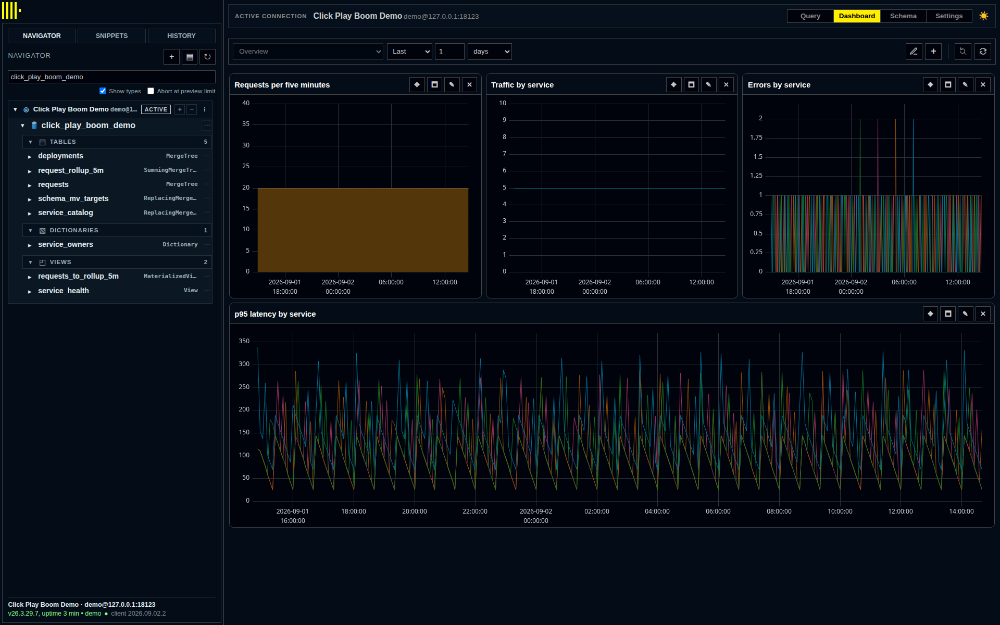
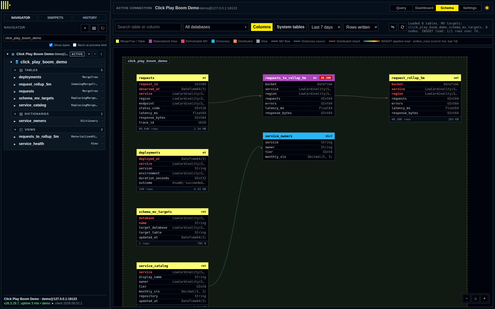
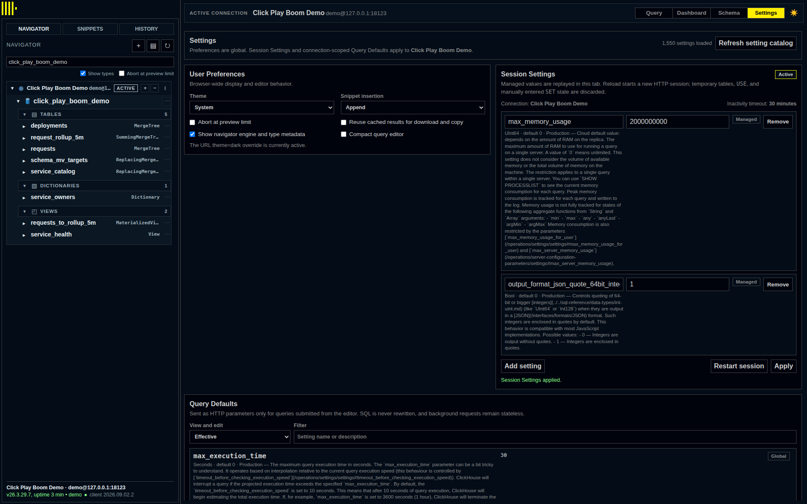

# Click Play Boom

**A full ClickHouse workbench delivered as one deployable HTML file.**

Click Play Boom turns the lightweight ClickHouse Play page into a browser workspace for exploring servers, writing and running SQL, inspecting
results, monitoring dashboards, visualizing schemas, and managing query behavior. Deployment is simply: open
[`click-play-boom.html`](./click-play-boom.html). The application needs no web server, framework, package installation, or startup resource fetches;
serving the same file over HTTP is optional.


## Four Workspaces, One Connection

| Workspace | What it provides |
| --- | --- |
| **Query** | A script editor with schema autocomplete, multi-statement execution, result tabs, history, charts, downloads, and formatted copying. |
| **Dashboard** | Native rendering of ClickHouse dashboards with time controls, synchronized zoom, editable charts, reordering, and a JSON editor. |
| **Schema** | An interactive dependency graph with columns, engines, materialized-view flows, dictionary sources, details, and load heat maps. |
| **Settings** | Global preferences, managed per-connection HTTP sessions, and global or connection-scoped query defaults. |

The active saved connection follows you between workspaces. Dashboard, Schema, navigator, autocomplete, download, and query-log requests remain
stateless; only queries submitted from the editor participate in its managed session and Query Defaults.

## Query Workspace


The editor works as a SQL script buffer rather than a single-query box:

- Run the selected text, or every statement when there is no selection, with `Ctrl+Enter` / `Cmd+Enter`.
- Split scripts with the embedded ClickHouse WebAssembly lexer, with a simple semicolon fallback when WebAssembly is unavailable.
- Execute statements sequentially and keep each response in its own status-bearing result tab.
- Complete databases, tables, views, dictionaries, and columns from lazily loaded schema metadata.
- Use four-space Tab indentation, Shift+Tab outdent, syntax highlighting, a resizable editor, and compact mode.
- Render streaming table results, raw formats, `JSONCompactColumns` charts, and ClickHouse `EXPLAIN` graphs.
- Inspect row counts, transfer volume, query time, memory usage, and query-log statistics without losing prior results.
- Copy results as Markdown, CSV, or TSV; copy a query and its result as one Markdown document; or download in any ClickHouse output format.
- Optionally reuse ClickHouse query-cache entries for result copying and downloads instead of rerunning expensive queries.

The sidebar complements the editor with:

- Multiple saved connections organized into folders, with connection status and server version visible at a glance.
- A lazy schema navigator whose database, table, view, dictionary, and numeric-column actions generate useful SQL safely into the editor.
- Searchable snippet folders with append, insert-at-cursor, and replace modes, ordering controls, and JSON import/export.
- Per-statement execution history linked back to the corresponding result tab.

## Dashboard Workspace



Dashboard loads the definitions exposed by `system.dashboards` and renders them inside the application using the active connection. Relative or
absolute time ranges and bucket controls apply immediately, while charts support synchronized zoom, reset, height expansion, and drag reordering.
Charts can be added, edited, or removed transiently, and the entire working dashboard can be edited as JSON.

The repository includes [`demo/dashboard.json`](./demo/dashboard.json), the four-chart definition used for the screenshot above.

## Schema Workspace



Schema turns ClickHouse metadata into an interactive graph:

- Search tables and columns, filter databases, include system tables, and toggle column details.
- Follow table/view dependencies, materialized-view targets, dictionary sources, and Distributed table relationships.
- Inspect engine details, keys, row/byte counts, comments, refresh state, and lazily formatted `CREATE` statements.
- Re-layout, drag, select, and zoom the graph.
- Colour materialized-view pipelines by executions, rows, bytes, duration, or memory recorded in `system.query_views_log`.
- Supply compatibility metadata for ClickHouse versions that do not expose materialized-view targets in `system.tables`.

## Settings Workspace


Settings centralizes browser preferences and query behavior. Its virtualized, ranked settings picker exposes every matching entry from
`system.settings` without rendering the entire catalog into the DOM.

Session Settings are managed per connection and browser tab. The application replays configured values into a dedicated ClickHouse HTTP session,
detects busy or expired sessions, performs one controlled recovery, and starts a fresh session after a page reload. Query Defaults are sent as HTTP
parameters for editor queries without rewriting SQL; global values can be overridden or suppressed per connection and tested before use.

## Quick Start

Open [`click-play-boom.html`](./click-play-boom.html) directly in a browser. A file-based launch defaults to:

```text
http://localhost:8123/
```

When served over HTTP, the initial connection defaults to the page's origin. Explicit connection details can be supplied in the URL:

```text
click-play-boom.html?url=http%3A%2F%2Flocalhost%3A8123%2F&user=default
```

The app sends `add_http_cors_header=1`, so ClickHouse must be reachable from the browser and allow the request. Saved connection details, including
passwords, are kept in browser `localStorage`; use this as a local/development convenience rather than a secure secret store. A password supplied in
the URL is removed from the address after the page initializes, but is still stored with the saved connection.

## Reusable Demo Environment

The committed demo creates an isolated ClickHouse 26.3 LTS instance and a realistic `click_play_boom_demo` database. It includes MergeTree tables,
an active materialized-view pipeline, a normal view, a dictionary, compatibility metadata for the Schema workspace, 80,640 request events, and 240
deployment records. Initialization runs only when the demo volume is first created.

Start it:

```bash
docker compose -f demo/compose.yaml up -d --wait
```

Open [`click-play-boom.html`](./click-play-boom.html) directly. In the Navigator, select **New connection** (`+`) and enter the demo connection
details below. No application server is required.

The demo endpoints and credentials are:

| Setting | Value |
| --- | --- |
| HTTP interface | `http://localhost:18123/` |
| Native interface | `localhost:19000` |
| Username | `demo` |
| Password | `clickplayboom` |
| Database | `click_play_boom_demo` |

Inspect the seeded data from the command line:

```bash
docker compose -f demo/compose.yaml exec clickhouse \
  clickhouse-client --user demo --password clickplayboom \
  --query "SELECT service, count() FROM click_play_boom_demo.requests GROUP BY service ORDER BY service"
```

To recreate the data from the initialization scripts, remove only the demo containers and volume, then start it again:

```bash
docker compose -f demo/compose.yaml down --volumes
docker compose -f demo/compose.yaml up -d --wait
```

To reproduce the Dashboard screenshot, open the Dashboard workspace, choose **Edit dashboard JSON**, replace the editor contents with
[`demo/dashboard.json`](./demo/dashboard.json), and apply the change.

## Deployment and Development

The repository separates maintainable source from the deployable artifact:

- [`click-play-boom.html`](./click-play-boom.html) is the generated, committed application. Open or deploy this file.
- [`src/`](./src/) contains the editable HTML, CSS, JavaScript, templates, and embedded assets.
- [`tools/build-single-file.mjs`](./tools/build-single-file.mjs) assembles the source tree into the root HTML artifact.
- [`demo/`](./demo/) contains the reproducible ClickHouse environment and screenshot dashboard definition.

No npm installation or bundler is required to run the generated application. Development uses Node for the small build tool and Playwright for the
focused browser safety tests. Edit files under `src/`, then regenerate the artifact:

```bash
npm run build
```

Install the repository-managed pre-commit hook once to regenerate and stage the artifact automatically:

```bash
npm run hooks:install
```

Useful checks are:

```bash
npm run build:check
npm run browsers:install
npm run test:query-submit
node --check tools/build-single-file.mjs
find src/scripts -name '*.js' -print0 | xargs -0 -n1 node --check
docker compose -f demo/compose.yaml config --quiet
```

The generated page embeds its CSS, application JavaScript, templates, icons, and ClickHouse lexer. It loads no external resources during startup;
the larger upstream visualization libraries used for charts and `EXPLAIN` graphs are fetched lazily only when those features are requested.

## Lineage

Click Play Boom is a substantial rework of the ClickHouse Play page from
[`ClickHouse/ClickHouse` v26.3.3.20-lts](https://github.com/ClickHouse/ClickHouse/blob/v26.3.3.20-lts/programs/server/play.html), preserving its clean,
fast, standalone deployment model while expanding it into a practical day-to-day workspace.
